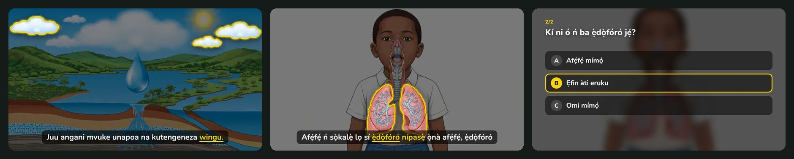
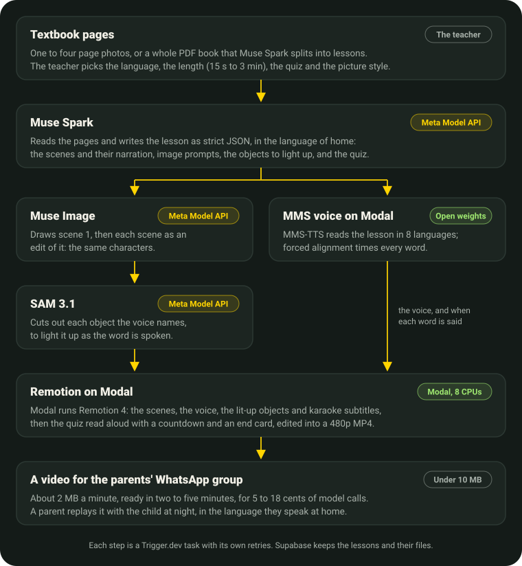

<p align="center">
  
</p>

<h1 align="center">LessonCast</h1>

<p align="center">
  A textbook PDF, or a photographed page, in; narrated, illustrated video lessons out,<br>
  in the language the children speak at home. Education without borders.
</p>

<p align="center">
  <a href="https://lessoncast-ai.vercel.app"></a>
  
  <a href="LICENSE"></a>
</p>

<p align="center">
  
  <br>
  <sub>The water cycle in Swahili, the clouds lit as the voice says <i>wingu</i>. The lungs in Yoruba. A quiz question, answered.</sub>
</p>

## Why

Many children in Cameroon, and across Africa, learn in French, English, Portuguese or Spanish: a language
they don't speak at home. Science, history and geography reach them in that imported language, while the
language they think in, and the culture it carries, stays outside the classroom. Classes are crowded,
textbooks are shared, mobile data is expensive, and the printed page stays at school.

LessonCast carries the lesson across that border. The teacher uploads the textbook they already have, or
photographs a page of it, and a few minutes later gets a short video that explains it in the language of home, keeping the subject's own
terms and explaining them, so a child can learn science without leaving their language behind. The video is
small enough for the parents' WhatsApp group, and a parent can replay it with the child at night.

It started in Cameroon, and it isn't only for Cameroon: a page in any school language can become a lesson in
any language Muse Spark writes and an MMS voice reads, in Africa or anywhere a country's own languages are
kept out of its schools. Eight today, from Hausa to Swahili; each new MMS voice can join them.

## What a teacher does

1. Uploads the whole textbook as a PDF, which Muse Spark splits into lessons, or photographs one to four pages.
2. Picks the language, the length (15 s to 3 minutes), the quiz (none to five questions) and the picture
   style, or lets LessonCast choose from the pages.
3. Gets the video a few minutes later, with its scenes, its voice, subtitles that light up each spoken word
   and the objects the voice names, then the quiz read aloud.

No account, nothing to install: a phone and a browser.

## Eight languages

| Language | Spoken in | Voice |
|---|---|---|
| French | Cameroon, official language | `facebook/mms-tts-fra` |
| English | Cameroon, official language | `facebook/mms-tts-eng` |
| Pidgin (Kamtok) | Cameroon, Nigeria | `facebook/mms-tts-pcm` |
| Hausa | Northern Cameroon, Nigeria, Niger | `facebook/mms-tts-hau` |
| Fulfulde | Northern Cameroon, the Sahel | `facebook/mms-tts-ful` |
| Yoruba (Yorùbá) | Benin, Nigeria | `facebook/mms-tts-yor` |
| Fon (Fɔngbè) | Benin | `facebook/mms-tts-fon` |
| Swahili (Kiswahili) | DR Congo, East Africa | `facebook/mms-tts-swh` |

Each one is a language Muse Spark can write and an open MMS voice from Meta can read, with its own letters
(ɓ ɗ ƙ, ŋ ƴ, ẹ ọ ṣ, ɖ ɛ ɔ) and its own pace: a Swahili lesson gets fewer words than a Yoruba one for the
same minute. Cameroon's own languages, such as Ewondo, Duala or Basaa, have no MMS voice yet.

## How it works

<p align="center">
  
</p>

| Step | Model | What it does |
|---|---|---|
| Split a book into lessons | **Muse Spark** `muse-spark-1.3`, PDF input | Reads a textbook or ebook PDF (typed or scanned, up to 50 MB and 600 pages) in slices of 30 pages, and lists its lessons with their pages and a summary. No video is made until the teacher picks a lesson. |
| Write the lesson | **Muse Spark** `muse-spark-1.3`, Meta Model API | Reads the pages in one request, checks they are pages of school material, and writes the lesson as strict JSON in the chosen language: as many scenes and words as the length allows at that language's pace, an image prompt per scene, the objects each scene names, the quiz and the video's own words. In *Automatic* it also picks the picture style from the level and the subject. |
| Draw the scenes | **Muse Image** `muse-image-1.0`, Meta Model API | Draws scene 1 from a fixed style prompt (Illustrated, Realistic, Diagram or Comic), then every other scene as an edit of scene 1, so the characters stay the same. |
| Speak | **MMS-TTS**, open weights on Modal | Reads the narration and the quiz in the chosen language. Each voice loads the first time its language is used. |
| Time every word | **MMS forced alignment** (torchaudio `MMS_FA`), open weights on Modal | Gives each word its start and end: the karaoke subtitles, the length of every scene and the quiz's countdown. |
| Cut out the objects | **SAM 3.1** `sam-3.1`, Meta Model API | Finds each object the narration names ("the heart", "the clouds") in its drawing and returns its outline. When the voice says the word, the rest of the scene dims and the object lifts, outlined in yellow. An object SAM can't find is left out; SAM never fails a lesson. |
| Edit the video | Remotion 4, on Modal | Title card, scenes with slow zooms and crossfades, the cut-outs lit on their words, subtitles, the quiz with a countdown and the right answer, end card. 854 × 480 H.264 at 300 kbit/s. |

## Built with

| Layer | What we use |
|---|---|
| Site | Next.js 16 (App Router, Cache Components), React 19, TypeScript in strict mode, Tailwind CSS 4 |
| Pipeline | Trigger.dev 4: one task per lesson, a child task per step with its own retries |
| Meta models | Muse Spark, Muse Image and SAM 3.1 on the Meta Model API; MMS-TTS and MMS forced alignment, open weights |
| Voice and video | Modal: Python and PyTorch for MMS, Node and Remotion 4 for the render, both started for the lesson and stopped after it |
| Data | Supabase Postgres (row-level security on, server only) and Storage; Modal uploads through signed URLs and never holds the keys |
| Contracts | Zod schemas for every model answer, sent to Muse Spark as a strict JSON schema |
| Tests | Vitest (281 tests, the live Supabase ones included), Python `unittest` for the Modal helpers |

## What a lesson costs

Measured on real lessons, from the upload to the finished video:

| Lesson | Ready in | Model calls | Video |
|---|---|---|---|
| 1 minute in Swahili, one question (production) | 2 min 13 s | $0.058 | 1.9 MB |
| 1 minute in Yoruba, two questions | 2 min 20 s | $0.069 | 1.7 MB |
| 3 minutes from a book lesson, in Pidgin (production) | 4 min 37 s | $0.182 | 6.1 MB |
| Reading a 39-page science textbook into 8 lessons | 38 s | | |

Every lesson page shows its own times and costs as a live graph of the pipeline. The derisk tests that set
these choices are in [`docs/derisk.md`](docs/derisk.md).

## What comes next

Today LessonCast serves one teacher with one phone. Next, it grows to serve whole schools:

- **Testing with teachers and parents** in Cameroon, on their own textbooks and phones, to learn what makes a
  lesson worth replaying at home.
- **Teacher accounts**: each teacher keeps their books and lessons in one place, shares them with their
  classes, and can correct a script before its video is made.
- **Subscriptions for schools and NGOs**: a lesson costs five to eighteen cents of model calls, so a few free
  lessons for every teacher, then plans for schools, ministries and NGOs that pay for whole classes.
- **More languages of home**: MMS speaks over a thousand languages, and each new voice can join. Next come
  Ewondo, Duala and Basaa, which have no voice yet, and a voice note read by Omnilingual ASR in place of a photo.
- **Ready for a whole country**: the voice on Modal GPUs (about six seconds of compute instead of a minute), more
  lessons made at once, and a lesson already made never made twice.
- **Straight from WhatsApp**: a teacher sends a page to a WhatsApp number and gets the video back in the same
  chat.

## Architecture

```
Browser (teacher or judge)
  │ 1 to 4 page photos, each shrunk in the browser to a JPEG of at most 1600 px, or a PDF book;
  │ the language (8), the length (15 s to 3 min), the quiz (0 to 5 questions), the style
  ▼
Next.js 16
  │ POST /api/lessons      checks → pages to Supabase Storage → lessons row → trigger generate-lesson
  │ GET  /api/lessons/:id  status, scenes drawn so far, each step's metrics, the video (polled every 2 s)
  │ POST /api/books        a signed URL: the browser uploads the PDF straight to Supabase Storage
  │ POST /api/books/:id/read, GET and PATCH /api/books/:id, POST /api/books/:id/lessons (one lesson's video)
  ▼
Trigger.dev
  read-book            the PDF in slices of 30 pages → Muse Spark → the book's lessons (no video yet)

  generate-lesson ─┬─ write-script      Muse Spark → lesson (Zod) from the photos, or the lesson's pages cut from the PDF
                   ├─ draw-scenes  ┐    Muse Image: scene 1, then the others as edits of it, 4 at a time
                   │  narrate      ┘    Modal lessoncast-voice: MMS-TTS + MMS_FA → WAV + word timings
                   ├─ find-highlights   SAM 3.1: one request per named object → highlights.json
                   └─ render-video      Modal lessoncast-render: Remotion → MP4
  ▼
Supabase: the lessons and books tables (RLS on, server only) and the public "lessons" bucket
```

Waiting on child tasks is not billed, so a lesson costs only the work it does.

```
src/app          the site: landing, /create, /lessons, /lessons/[id], /books/[id], How it works, Why LessonCast, the API
src/lib          lesson schema, languages, lengths and styles, the pipeline's logic, Meta Model API and Modal clients, Supabase
src/remotion     the LessonVideo composition
src/trigger      the Trigger.dev tasks
modal/           voice.py (MMS) and render.py (Remotion), deployed to Modal
supabase/        database migrations
scripts/         smoke test, run a lesson without the site, record the Remotion fixture, derisk tests
docs/            derisk.md, and the pictures of this README
```

## Run it locally

You need Node 22 or later, pnpm 10, Python 3.12, and accounts on the Meta Model API, Supabase, Trigger.dev and
Modal.

1. Install: `pnpm install`.
2. Copy `.env.example` to `.env` and fill it in. The file lists every variable.
3. Create the database: run each file of `supabase/migrations/` in order with
   `psql "$SUPABASE_DB_URL" -f <file>` (use the Session pooler address).
4. Deploy the Modal apps:
   ```bash
   python3 -m venv scripts/derisk/.venv
   scripts/derisk/.venv/bin/pip install -r scripts/derisk/requirements.txt
   scripts/derisk/.venv/bin/modal setup
   scripts/derisk/.venv/bin/modal deploy modal/voice.py
   scripts/derisk/.venv/bin/modal deploy modal/render.py
   ```
5. Set your Trigger.dev project ref in `trigger.config.ts`, then run the site and the worker side by side:
   `pnpm dev` and `pnpm trigger:dev`.
6. Open http://localhost:3000, or check the whole pipeline from the terminal:
   `pnpm smoke swh auto page.jpg`.

Tests: `pnpm test` (the tests that call Supabase and Modal run when `.env` has their keys and skip otherwise),
`pnpm typecheck`, `pnpm lint`, and for the Modal helpers
`scripts/derisk/.venv/bin/python -m unittest discover -s modal`.

## Built during the Meta Global AI Developer Hackathon

Everything in this repository was written during the event (26 October to 4 November 2026), starting from an
empty `create-next-app` on 26 October: first the derisk tests, then the pipeline, then the site, the books and
the eight languages. The commit history and the pull requests show each step.

## Licenses

The code is under the [MIT license](LICENSE). The MMS-TTS voices are released by Meta under CC-BY-NC 4.0, for
non-commercial use. Muse Spark, Muse Image and SAM 3.1 are used through the Meta Model API under its terms.
Remotion has its own license, free for individuals and small teams. Nunito and Noto Sans are under the SIL
Open Font License.
